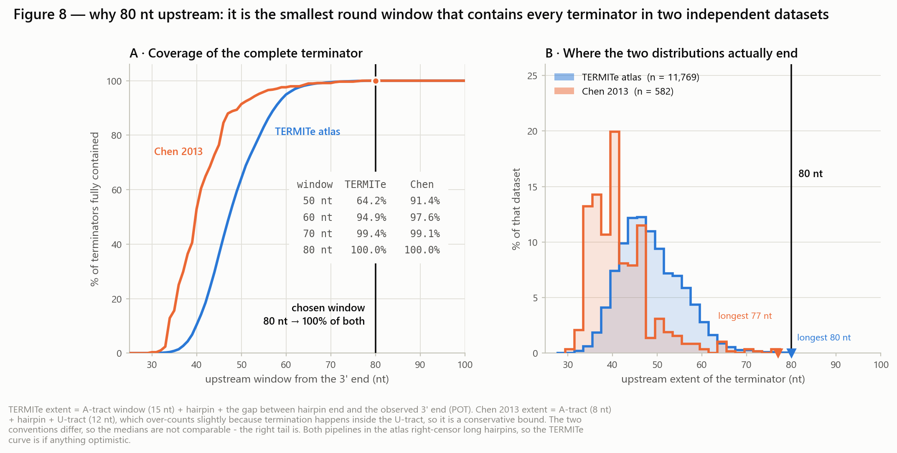
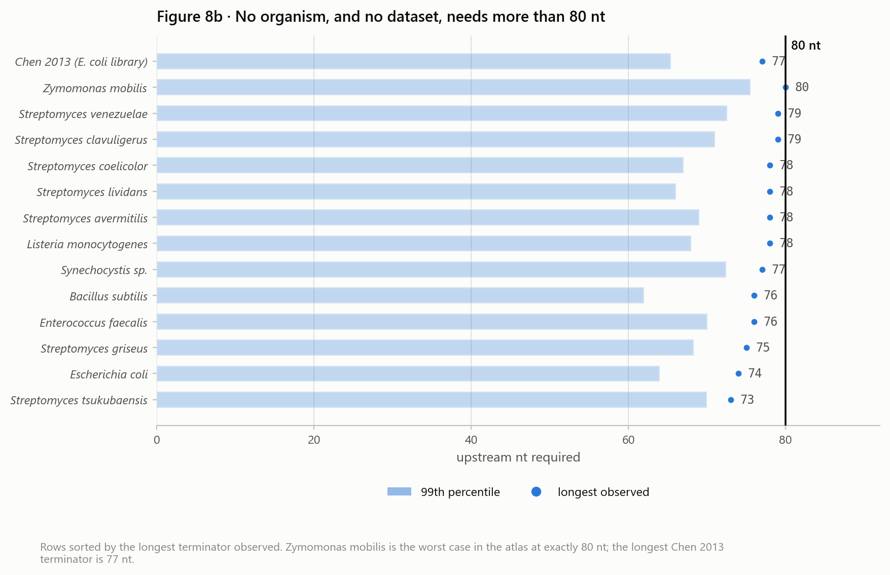
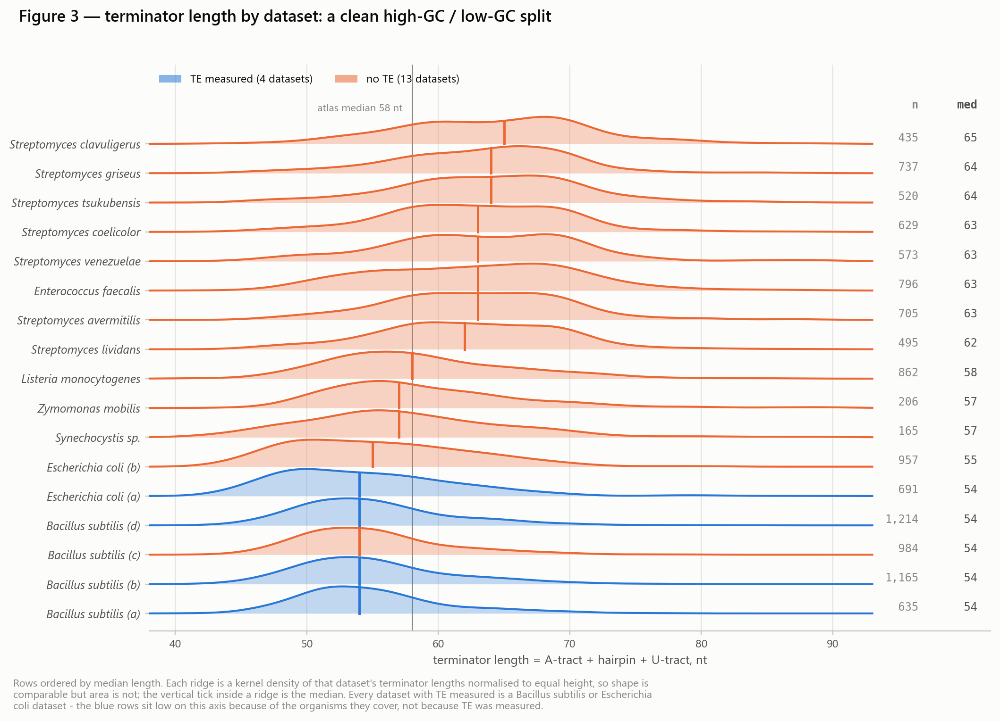

Just a stock saving stuff generated by claude but later I decide not to use this.

### Why 80 nt upstream

Measured back from the 3' end, the whole terminator (A-tract + hairpin + U-tract) fits inside
80 nt in **every** terminator of two independent datasets — the TERMITe atlas (`D08`; 11,769
terminators, 13 organisms, Term-seq) and Chen et al. 2013 (`D02`; 582 terminators, *E. coli*
dual-fluorescence reporter library). The two share no assay, no annotation convention and no
organism beyond *E. coli*, so the agreement is not circular.

| upstream window | TERMITe atlas | Chen 2013 |
|---|---|---|
| 50 nt | 64.2 % | 91.4 % |
| 60 nt | 94.9 % | 97.6 % |
| 70 nt | 99.4 % | 99.1 % |
| **80 nt** | **100 %** | **100 %** |

The longest terminator in the atlas reaches exactly 80 nt (*Z. mobilis*) and the longest in
Chen 2013 reaches 77 nt, so 80 nt is the smallest round window that loses nothing in either
set. 70 nt would still truncate roughly 1 terminator in 150, and those are the long-stem
*Streptomyces* and *Z. mobilis* cases that a structure-sensitive model can least afford to see
cut off. Both annotation pipelines in the atlas right-censor long hairpins (hairpin ceilings of
40 and 59 nt), so 80 nt is a floor rather than a ceiling.

Derivation, per-organism breakdown and caveats: [`terminator_length_distributions.ipynb`](terminator_length_distributions.ipynb) §9.
The downstream 19 nt is set on other grounds.

### Terminator length in the TERMITe atlas

Terminator length = A-tract + hairpin + U-tract, computed separately for each of the atlas'
two annotation protocols:

| | n | median | IQR | 90 % range | full range |
|---|---|---|---|---|---|
| TransTermHP protocol | 8,212 | 56 nt | 52–63 | 48–73 | 41–89 |
| RNAfold protocol | 10,720 | 58 nt | 53–64 | 48–70 | 42–70 |
| combined | 11,769 | **58 nt** | 53–64 | 48–71 | 41–89 |

Length splits into two regimes set by GC content rather than by phylogeny: *Streptomyces*
(GC ≈ 70 %) at medians of 62–65 nt, everything else at 54–58 nt, with *E. faecalis* the one
low-GC exception. That is the main argument for fine-tuning within one organism rather than
pooling — a length or MFE feature does not mean the same thing in a 70 %-GC genome.

Three caveats, all documented in the notebook: both atlas pipelines right-censor long hairpins;
the A- and U-tract columns are fixed 15-nt reporting windows, so the sum above is exactly
`hairpin + 30` and all shape variation comes from the hairpin; and **183 of the 3,561
termination-efficiency values in Supplementary Table 2 are corrupted into Excel date serials**
and must be repaired before use.
