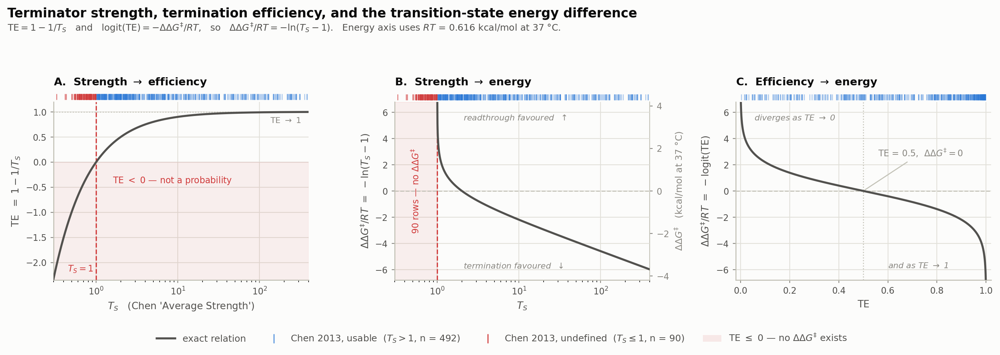

# `probing/` — RNA-FM embeddings → termination efficiency

Implementation, not inventory. The repo root `README.md` is a *survey*: what public data
exists for intrinsic transcription termination and what it can support. This folder is the
first thing built **on top of** that survey — taking a frozen RNA foundation model and asking
whether its embeddings already carry termination-relevant signal.

**Status (2026-09-02):** embeddings load and run. No probe trained yet. Everything below the
"Getting embeddings" section is design, not result.

---

## The question

RNA-FM was pre-trained on ncRNA with no exposure to termination labels. If a *linear* head on
frozen embeddings predicts TE well, the grammar of intrinsic termination is already partly
represented in the model, and the sequence track in the root README is worth pursuing. If it
does not, that is also informative: it argues for domain-adaptive continued pre-training on
terminator corpora (`D07`/`D09`/`D10`) before any fine-tuning.

Probing is deliberately the cheap experiment that runs first. Frozen backbone, small head,
no GPU needed.

```
  terminator sequence
        |
        v
  RNA-FM  rna_fm_t12  (frozen, 99.5 M params, 12 layers, 640-dim/token)
        |
        v
  pool over the terminator window       <- design choice, see "Open choices"
        |
        v
  ridge / linear head                   <- the only thing trained
        |
        v
  logit(TE)
```

## Files

```
embeddings_smoke.ipynb   loads the local checkpoint, embeds 3 toy sequences,
                         prints (batch, len+2, 640). Proves the environment works.
                         Was try.ipynb at the repo root.
plot_te_energy.py        renders figures/te_energy_relationship.png
figures/
  te_energy_relationship.png   how T_S, TE and ddG++ map onto each other
```



The three relations are deterministic, so the 582 measured terminators appear as marginal
rugs rather than a scatter — plotted as points they would simply retrace the curve. What the
rug shows is *where along it the data sits*: the usable 492 span
$\Delta\Delta G^{\ddagger}$ = -3.66 to +3.48 kcal/mol at 37 °C (-5.94 to +5.65 $RT$), and
the 90 undefined pile up against the $T_S = 1$ wall in panels A and B with nowhere to go on
the energy axis. Panel C shows why the target is steep at the ends: near TE = 0 or 1 a tiny
change in efficiency is a large change in energy, so the top and bottom of the range carry
the most label noise per unit of $\Delta\Delta G^{\ddagger}$.

Weights are **not** here — they live in the gitignored `RNA-FM_stuff/` at the repo root.
See `RNA-FM_stuff/SOURCE.md` for provenance, checksum and download URL.

## Getting embeddings

Two things bite, both already handled in `embeddings_smoke.ipynb`:

1. **`torch.load` refuses the checkpoint.** `rna-fm` 0.2.2 calls `torch.load()` without
   `weights_only=False`; PyTorch flipped that default to `True` in 2.6 and the checkpoint
   carries an `argparse.Namespace`. Allowlist that one class — do not pass
   `weights_only=False`, which re-enables arbitrary code execution on unpickle.

   ```python
   torch.serialization.add_safe_globals([argparse.Namespace])
   ```

2. **A wrong path silently re-downloads 1.19 GB.** `fm.pretrained.rna_fm_t12(path)` falls back
   to fetching from CUHK when `path` does not exist, with no warning. Assert first. The
   notebook anchors to the repo root by walking up to `datasets_v2.csv`, so it works from any
   cwd.

Output is `(batch, longest_len + 2, 640)` — BOS and EOS are included, strip them before
pooling. RNA-FM expects **RNA** alphabet, so `T` → `U` on the way in.

## The label, and the trap in it

Labels come from Chen 2013 (`D02`), chosen in the root README because it is one assay, one
organism, one construct — 582 E. coli terminators by dual-fluorescence reporter.

The sequence decomposition is already tidied in `../Chen_2013_terminators/terminator_lengths.csv`
(582 rows: `A-tract`, `Hairpin`, `Loop`, `U-tract`, `Structure`, plus lengths). **That file has
no TE column.** The measurement lives in the original supplements:

| file | sheet | rows | what |
|---|---|---|---|
| `41592_2013_BFnmeth2515_MOESM206_ESM.xlsx` | `Fig2a-natural` | 317 | natural, `ECK…` |
| `41592_2013_BFnmeth2515_MOESM207_ESM.xlsx` | `Sheet1` | 265 | synthetic, `L3S…` |
| `41592_2013_BFnmeth2515_MOESM208_ESM.xlsx` | 2 sheets | — | the authors' QC-filtered subsets |

Join on `Name`. The label column is **`Average Strength`** = Chen's $T_S$, not TE:

$$T_S = \frac{\mathrm{GFP}_{\mathrm{term}}/\mathrm{RFP}_{\mathrm{term}}}{\mathrm{GFP}_0/\mathrm{RFP}_0}$$

Converting to the root README's training target:

$$\mathrm{TE} = 1 - \frac{1}{T_S}, \qquad
\mathrm{logit}(\mathrm{TE}) = \ln\frac{\mathrm{TE}}{1-\mathrm{TE}} = \ln\left(T_S - 1\right)$$

So `logit(TE)` is just `log(strength - 1)`. Which is where the trap is:

> **90 of 582 terminators (15%) have $T_S \le 1$**, so TE ≤ 0 and `logit(TE)` is undefined.
> `np.log` returns `nan`/`-inf` rather than raising, so they will quietly poison a regression.
>
> Note this is **not** the same as `logit(TE)` merely being negative. A negative logit just
> means TE < 0.5 (readthrough favoured) and is completely fine — 133 rows sit there and need
> no handling. The 90 are rows where **TE itself is negative**, as low as -2.06, so
> `logit` is undefined. Since $\mathrm{logit}(\mathrm{TE}) = -\Delta\Delta G^{\ddagger}/RT$ only maps to an energy for TE in (0,1),
> these are not large barriers; they are values that are not probabilities.

These are not evenly spread and not simply noise. Splitting the synthetic sheet by strength:

| $T_S$ group | n | median induced GFP | median induced RFP | median GFP/RFP |
|---|---|---|---|---|
| ≤ 1 | 67 | 13,923 | 10,634 | 1.47 |
| 1–2 | 58 | 13,460 | 6,092 | 2.79 |
| 2–5 | 45 | 14,029 | 2,978 | 5.11 |
| > 5 | 95 | 17,050 | 104 | 169.9 |

GFP is flat across the whole range (~14k; 1.27× spread in the natural sheet too) — RFP carries
the entire signal, as the `P_BAD → GFP → terminator → RFP` construct implies. The reference is a
single shared constant: `Average GFP/RFP ÷ Average Strength` = 1.9900 for every synthetic row,
IQR exactly zero. So $T_S \le 1$ means "GFP/RFP came out below 1.99", and the ≤ 1 group's RFP
(~10.6k) sits *above* the implied no-terminator RFP₀ (≈ 14,000/1.99 ≈ 7,000). Measured as
anti-terminating, not as weakly terminating.

They concentrate in the synthetics — **67/265 (25%)** vs **15/227 (7%)** for natural forward.
Two contributions: designed library members that genuinely do not terminate pile up at the
$T_S \approx 1$ boundary where noise pushes half below it, plus construct-specific effects on
RFP (RNase sites, structure at the RFP RBS) that a single shared control cannot absorb. That
second one is the weakness `datasets_v2.csv` already records for `D02` — no GFP/RFP position
swap, no RNase-site standardisation, cf. Cambray 2013 — showing up quantitatively.

Ruled out as explanations: the 90 reverse-orientation `-R` controls (only 8 of them are ≤ 1;
median 2.23 — a reversed hairpin is still a hairpin), and the authors' QC sheets in MOESM208
(24 rows, zero overlap with the 582).

Decide explicitly, and record which you chose:

- **drop** them — cleanest, costs 15% of an already small set, and biases the label
  distribution away from weak terminators
- **floor** $T_S$ at some $1+\epsilon$ — keeps n, but invents a TE for constructs the assay
  placed *off* the TE scale entirely; hard to justify given the RFP evidence above
- **censored likelihood** — treats them as "TE below detection", the statistically honest
  option and the most work

Whichever you pick, report it stratified: a probe scored only on the 492 usable rows is scored
on a set that is 84% natural-forward.

## Open choices

Nothing here is settled; these are the knobs that will decide whether the probe means anything.

- **Which layer.** Last layer is not automatically best for probing — mid-stack often wins.
  Sweep all 12 rather than assuming layer 12.
- **How to pool.** Mean over the window, mean over the hairpin only, the U-tract tokens, or
  BOS as a sequence summary. Termination is local, so whole-sequence mean pooling may dilute
  exactly the signal being looked for.
- **What window.** Root README argues 90 nt upstream + 19 nt downstream. Chen's `Sequence`
  column is the cloned insert (terminator **plus** vector scaffold, 23–168 nt), so the window
  has to be cut deliberately rather than inherited from the file.
- **Splits.** Random splits leak: `L3S…` synthetics are combinatorial variants sharing stems.
  Split by sequence similarity, and keep natural/synthetic as a reported stratum — their
  strength distributions differ (median $T_S$ 4.70 vs 2.13).

## Baselines the probe has to beat

A probe that only ties these has shown nothing.

1. Hand-crafted features already computed in `../outputs/terminator_length/terminator_features.csv`
   — hairpin length, stem bp, loop length, U-tract length — into the same ridge head.
2. One-hot sequence into the same head. Separates "the embedding is useful" from
   "the head is useful".
3. Published thermodynamic predictors, for external context.

---

**Related.** Root `README.md` — dataset inventory and the argument for `D02`.
`RNA-FM_stuff/SOURCE.md` — weights provenance and loading.
`ENVIRONMENT.local.md` — venv and how to run things (gitignored, local only).
