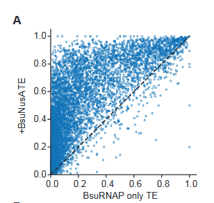

# data landscape for intrinsic transcription termination

A survey of what public data exists for predicting bacterial intrinsic transcription
termination efficiency (TE) from sequence, and what it can and cannot support.

Maintained by Siwei Qian. Last updated 2026-07-24.

2026-10-04: moved here from the repo root once the repo grew past the survey. The project
overview is now the [root README](../README.md). Paths in **Files** below are from the repo root.

**Start with [`datasets_v2.csv`](datasets_v2.csv).** It is the inventory. Everything below is
the argument for why the inventory looks the way it does.

---


## Study Preliminary Plan
Goal: build a model that can predict termination efficiency (TE) from sequence. See how it compare to state of the art models, and also see if we can do any interpretability analysis on the model to see if we can find any new insights about the mechanism of intrinsic transcription termination.

Need to train on logit(TE). Previous studies show that this can improve performance of the model, also it can match TE to the scale of energy, as  

$$
\mathrm{logit}(\mathrm{TE}) = -\frac{\Delta\Delta G^{\ddagger}}{RT},
\qquad
\Delta\Delta G^{\ddagger} = \Delta G^{\ddagger}_{\mathrm{term}} - \Delta G^{\ddagger}_{\mathrm{read}}
$$

Tracks:
- Construct a self-supervised regression masked language model (MLM) to learn the grammar of intrinsic transcription termination. Pre-train on non-coding RNA sequences (preferrably pause/intrinsic termination sequences), and fine-tune on the labeled TE datasets.
   
   **Reason for the method selected:** Current state-of-the-art TE predictors rely on hand-crafted structural and thermodynamic features. Public labeled data is limited in two distinct ways:

   - *Quantity.* Clean sequence–TE pairs number in the 10²–10³ range for any single combination of assay, organism, and condition.
   - *Quality.* Every public available labeled TE dataset is measured in vivo, so the readout is convolved with mRNA degradation, 3' processing, translational context, and genomic context etc. Battaglia et al. 2026 rebuilt terminators in a controlled in vitro setting before measuring anything they intended to train on, for exactly this reason.

   Self-supervised pre-training addresses the first constraint and not the second. That is acceptable here because of how the target is scoped. The aim is to predict TE *in vivo, in one organism* — for applications such as designing synthetic terminators with a desired strength in that organism. For that target the in vivo confounds are shared with the deployment context: a terminator placed on a plasmid in E. coli is subject to the same degradation and translational effects that Chen et al. measured. The labels are matched to the use case rather than compromised relative to it, and quantity becomes the binding constraint.

   The quality constraint does bind on the mechanistic question — which rate a given sequence feature changes — and that is what the CTMC track (see below) and in vitro data are for.

   Requirement of the sequence foundation model: single nucleotide resolution, input size 90 upstream to 19 downstream of the terminator (will further refine this part), output logit(TE). 
   - why 90 upstream: checked TERMITe atlas and Chen et al 2013, this range can cover all the size of terminators
   - why 19 nt downstream: downstream DNA is known to affect intrinsic termination efficiency. Also Battaglia et al 2026 did 19 nt in their training.
   
   vocab (must have and will be transformed to token form): `A`, `C`, `G`, `T`, `N` (unknown), `[pad]`, `[mask]`
   
   Anchor option: 
   - 3' end of the sequence (Transcription termination site + 19 nt downstream sequence)
   - transcription termination site (TTS)
   
   Note after a few search on 07/27/2026: need to re-consider this. because intrinsic termination is multi-site in nature (most terminator does), having a strict anchor site I listed above might not be a good idea. Need to consider other options and dive into more literature.

   Do sequence attention first, consider extend to structure validation cross-attention. 
   
   A realistic aim based on current landscape of research: can try to train model that can do better on predicting intrinsic termination in vivo in a specific organism, so possibily can aid making generative model to design synthetic terminators with desired TE in that organism. Interpretability-wise it will be in vivo specific and hardly be able to be applied to in vitro transcription factor free setting.
      


- Construct a kinetic model (Continuous time markov chain (CTMC)) to model the mechanism of intrinsic termination based on existing studies

   kinetic/thermodynamic parameters will be estimated from the sequence of terminators and other biochemical/biophysical studies. Then the information will be inputted to the model to estimate TE.

   The goal will be probing the mechanism of intrinsic termination and see how different conditions affect the termination process.
   
   Need good quality in vitro data 


## types of high-throughput experiments validated intrinisic transcription termination datasets with TE measured
- in vivo:

   Drawback: other transcription factors and cellular processes participate (e.g. mRNA degradation/stability, cryptic promoter, translational coupling, etc) which might skew the data heavily

   - dual fluorescence reporter from constructed terminator library on plasmid (e.g. construct: promoter - GFP - terminator - RFP) 
      
      - translational context might skew the data heavily, such as the fluorescence proteins at upstream and downstream might have differential translation efficiency due to RBS occlusion, which might skew the TE measured
      - terminator will be at the upper strand mRNA but not the lower strand mRNA, which might cause differential mRNA degradation and other processes
      - Specific design need to be taken (e.g. adding RNase recognition sites, swapping fluorescence proteins positions) to minimize unwanted factors that affect TE measurement (Cambray et al 2013 (D04)), but studies with ample amount of terminators often failed to do such quality control

      Observable: 

   - 3' end sequencing (Term-seq, SEnd-seq, etc) from genome-wide transcription

      - 3' end prone to degraded by exoribonuclease, which might skew the site of terminator and TE measured

      Observable: 

- in vitro:

   Drawback (also applied to in vivo): the TE measurement can be skewed by the length of sequencing reads in NGS (such as cannot identify whether a sequencing read is from a upstream transcription unit or a later transcription unit)

   - RNAP-seq/cell free genomic:
   - construct terminator libraries and measure TE in vitro using 3' end sequencing

   Currently there is no public in vitro dataset with TE measured. Froom 2026 (D01) is the only published and available cell free genomic dataset with TE, but the data isn't on GEO, I've contacted the author

Some evidence showing the likely difference between in vivo termination and in vitro termination:

<div align="center">



</div>

This is from Battaglia et al 2026 Figure 2S, on +/- B. subtilis NusA during in vitro transcription termination assay using intrinsic terminator library. 


### pre-training:

Can find if there is any good exisiting RNA foundation models that can suit our needs

Can also further pre-train existing RNA foundation models on the intrinsic transcription termination datasets (domain-adaptive continued pretraining)

If not, pre-train the model from scratch

Prefer to include cross-species information to the model


#### dataset that can be used:

| Source | Reason | ID |
|---|---|---|
| TERMITe atlas (Kosinski 2025) | 11,769 validated terminators from 3' end sequencing, 13 species, partially with TE; aggregated data from multiple studies | `D07` |
| BacTermFinder (Ghahfarokhi 2025) | 41,168 aggregated experimentally identified transcription ends (not only intrinsic terminators) from various methods 22 species, no TE included; aggregated data from multiple studies. Some overlap with TERMITe atlas | `D09` |
| NET-seq pause atlas (Larson 2014) | ~100k pause sites. Pause is a prerequisit stage of intrinsic termination. Recent study found that the `GS(N)7RY` consensus itself is important for intrinisc termination | `D10` |

The `datasets_v2.csv` contains the above datasets and more for pre-training (verify TBD)

### Probing/Fine-tuning:

Because intrinsic termination is very context-dependent, the model needs to be trained on a set of same condition (in vitro/in vivo), species/cell strain, and same type of assay & the construct. So I would suggest just select one dataset from one study

#### suggested dataset:

| Source | Type of assay | organism | number of intrinsic terminators with TE | ID | Note |
|---|---|---|---|---|---|
| Chen et al 2013 | in vivo dual fluorescence reporters | E. coli | 582 (natural + synthetic) | `D02` | |
| Froom et al 2026 | in vitro Cell free genomic/RNAP-seq | M. tuberculosis | 86–295 in vitro from the author's way of identification | `D01` | 2026-07-31 Obtained data from author via a link in SRA; Can compare this one with Chen to see which one is better. All in all depicts different information from Chen. might be able to expand the number of terminators in the dataset if do site-specific terminator (i.e. transcripts can have multiple adjacent termination sites each correspond to a different terminator) and/or re-evaluate the pipeline of peak-calling |
| TERMITe atlas (Kosinski 2025) | in vivo 3' end Term-seq | various species, ~13 datasets | Each species might have 500-1000 terminators | `D07` | Some data were produced from lab that do high quality research (e.g. Mandell et al 2022). Further diving into specific literature to check the quality and assay design need to be done |

Suggest to use Chen et al 2013 (D02) as it uses dual fluorescence reporter assay from a library of intrinsic terminators, which means that we don't need to worry that much about whether the TE measured at 3' end corresponds to the terminator ends at this position, or the position is a product after exonuclease cleavage. 

2026-07-31: Froom 2026 can also be used now.

The `datasets_v2.csv` contains the above datasets and more (verify TBD)

**Implementation of this track lives in [`probing/`](../probing/README.md)** — frozen RNA-FM embeddings into a linear head on `D02`. That README covers the setup, the `Average Strength` → `logit(TE)` conversion, and the open design choices.

---

## Guidance about using the CSV

Working stages column:

- `NEXT`: ready to read next
- `FUTURE`: not a priority now (especially because it is MLM related stuff, i.e. won't be able to be used for MLM)  will dig into it later
- `DONE`: read and understood
- `HOLD`: Need to verify more information from other sources that cannot be retrieved from the literature only.

Track：
- `MLM-pre`: masked language modeling pre training
- `MLM-fine`: masked language modeling fine tuning. It can also be used for pre-training (?)
- `CTMC`: kinetic model (continuous-time Markov chain / first-passage)
- `both`: can be used for both MLM fine tuning and also CTMC
- `none`: not used for either

`public` in `datasets_v2.csv` is `yes` / `no` / `UNVERIFIED`. Treat `UNVERIFIED` as unusable
  until checked.

---

## Files

```
public_dataset_survey/README.md          this file
requirements.txt               pinned deps for the analysis notebook
requirements-ml.txt            pinned deps for the modeling tracks; superset of the above
public_dataset_survey/datasets_v2.csv    the inventory as of 2026-07-28
Kosinski_2025_term-seq_sources_terminators_altas  the original data from Kosinski 2025 obtained from their supplementary
Chen_2013_terminators/         per-terminator length table from Chen 2013 (D02); see SOURCE.md inside
terminator_length_distributions.ipynb  terminator length analysis - definitions, per-protocol and
                               per-species distributions, the TE split, and the 80 nt window argument
outputs/terminator_length/     everything that notebook writes: figures/, tables/, and the tidy
                               per-terminator feature table terminator_features.csv
probing/                       RNA-FM embedding + probing experiments; see probing/README.md
20260630_BhaskarGroup_ppt_SiweiQian.pdf   Slides from Bhaskar group meeting 2026-06-30, with some discussion of baseline models trained on Chen's dataset.
```

## Notes and some further TODOs

Flanking region downstream of terminator, how much does Chen et al 2013 left with?

Why TERMITe when predict U tract length they used 15 nt? Is it because of their consideration of the multiple termination sites?

